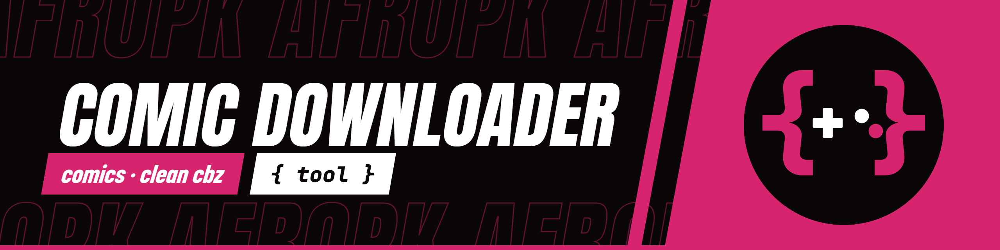
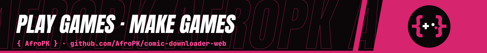

<p align="center">
  
</p>

<p align="center">
  
  
  
  
</p>

<p></p>

**`{ comic-downloader-web }`**: a local-only web app that saves comics as clean CBZ archives.

You paste a comic URL, it reads the chapters, and you download one chapter or the whole comic. Everything runs on your machine: Express backend, React frontend, Puppeteer for the page work. No account, no cloud, no uploads.

> [!NOTE]
> Sites must be allowed by hand in `backend/.env` — nothing is allowed by default. Only `batcave` is fully supported right now.

<p></p>

| | Feature | What it does |
|---|---|---|
| 📚 | **Chapter picker** | Loads the chapter list and metadata, then downloads only what you tick. |
| 🗜️ | **Clean CBZ** | Saves chapters as `.cbz` archives, or the full comic as one master `.zip` with a summary report. |
| 🔒 | **Local only** | Runs on `localhost`, keeps no data anywhere else. |
| 🧪 | **Tested backend** | Node's built-in test runner, plus CI on every push. |

<p></p>

**Needs:** Node.js 18+ · Chrome, Edge or Brave installed · git

```bash
git clone https://github.com/AfroPK/comic-downloader-web.git
cd comic-downloader-web
# Windows
setup.bat
# Linux / Mac
./setup.sh
```

1. Open `backend/.env` and set `TARGET_SITES` to the domain(s) you want, comma-separated, no spaces.
2. Start the app: `run.bat` on Windows, `./run.sh` on Linux/Mac.
3. Backend runs on `http://localhost:3000`, frontend on `http://localhost:5173`.

<p></p>

Open `http://localhost:5173`, paste a comic URL in the top bar and hit **Download**. When the chapters load, tick the ones you want as `.cbz`, or click **Download Full Comic** for one master archive.

<p></p>

- "URL not allowed" means the domain is missing from `TARGET_SITES`.
- "Puppeteer cannot launch" means no supported browser was found — set `PUPPETEER_EXECUTABLE_PATH` in `backend/.env` if yours is in a custom location.
- For personal use only. Respect the terms of service of the sites you use.
- MIT licence.

<p align="center">
  
</p>
